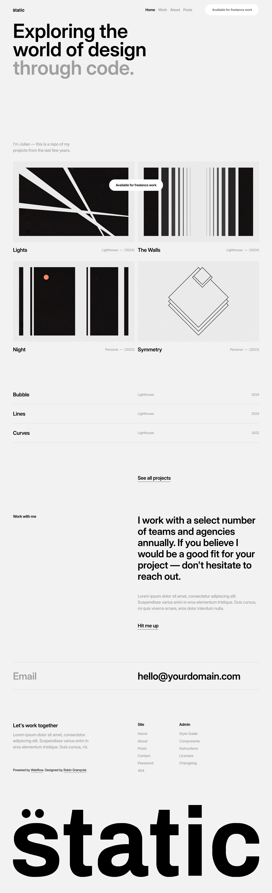
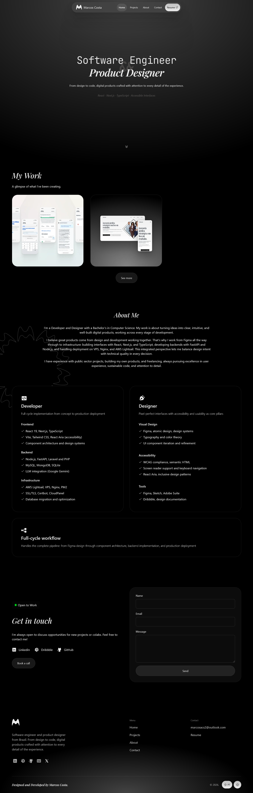
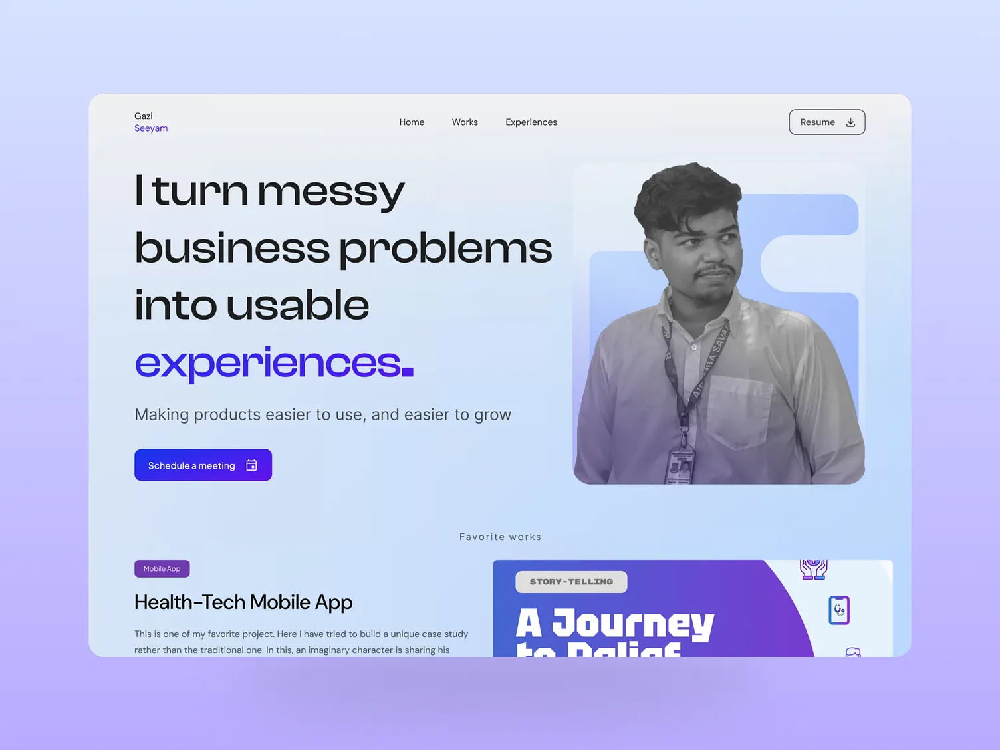

# Personal Portfolio Web Design System

Implementation blueprint for an early-career software developer whose experience centers on backend features, APIs, databases, and business logic. The portfolio should help a recruiter understand the developer’s focus, inspect an engineering contribution, and find contact information quickly.

Use an editorial visual direction: warm cream surfaces, bold black headings, restrained blue accents, numbered sections, and clear technical figures. Personality should come from typography, writing, and useful diagrams. Professional claims must describe actual work and distinguish individual responsibility from team outcomes.

### Visual reference library

The reference screenshots live in [`src/assets/inspirations/`](src/assets/inspirations/). Open the linked originals when comparing layouts during implementation; the previews below provide a quick visual index.

| Reference | File | Visual lookup notes |
| --- | --- | --- |
| 01 — Light editorial portfolio | [01.png](src/assets/inspirations/01.png) | Large left-aligned headline, generous whitespace, two-column project gallery, compact project rows, and prominent email footer. |
| 02 — Dark developer portfolio | [02.png](src/assets/inspirations/02.png) | Compact centered navigation, centered hero, project previews, grouped skills, and a contact section. |
| 03 — Split hero portfolio | [03.webp](src/assets/inspirations/03.webp) | Left-aligned headline and CTA beside a portrait, accent-colored headline emphasis, and a featured-work section below the hero. |

#### Reference 01



#### Reference 02



#### Reference 03



These screenshots supply layout references. The typography, palette, accessibility requirements, content rules, and implementation specifications in this document remain the baseline. The screenshots show other people’s portfolios; their identities, portraits, project claims, and copy are not portfolio content for this project. Keep these files as development references rather than importing them into the production application. Ignore adjacent `:Zone.Identifier` files, which are download metadata rather than images.

## 1. Stack

### Foundation

| Layer | Specification | Implementation guidance |
| --- | --- | --- |
| Application | React + TypeScript + Vite | Extend the existing starter. Use typed content and small functional components. |
| Styling | Tailwind CSS | Use the Vite integration and CSS theme tokens as the shared source of visual values. |
| Animation | Motion | Import from `motion/react`; reserve JavaScript animation for coordinated transitions and reveals. |
| Icons | Hugeicons | Use `@hugeicons/react` with `@hugeicons/core-free-icons`; import individual icons. |
| Routing | React Router | Use browser history for page URLs, with a shared layout and explicit unmatched-route view. |
| Content | Local typed TypeScript records | Keep project data separate from JSX. Add MDX only if long-form editing later warrants it. |
| Hosting | Cloudflare Pages | Build a static Vite application and publish `dist`. |

The repository currently contains the React/TypeScript starter; Tailwind, Motion, Hugeicons, routing, and portfolio content are planned additions. Retain the existing compiler and lint configuration unless implementation reveals a concrete incompatibility. Commit the lockfile and use its resolved versions for repeatable builds.

Setup during the Structure stage:

```sh
npm install react-router motion @hugeicons/react @hugeicons/core-free-icons
npm install -D tailwindcss @tailwindcss/vite
```

Add `tailwindcss()` alongside the existing React plugin in `vite.config.ts`, then import Tailwind in the global stylesheet. Replace the starter’s visual styles, including its automatic dark-mode rules, with the tokens below. The initial design uses a fixed light palette plus intentional dark sections.

These package patterns follow the official [Tailwind Vite guide](https://tailwindcss.com/docs/installation/using-vite), [Motion React installation guide](https://motion.dev/docs/react-installation), and [Hugeicons React quick start](https://hugeicons.com/docs/integrations/react/quick-start).

### Application and content architecture

```text
src/
  app/                 # Router, shared layout, route metadata and focus handling
  pages/               # Home, Work, CaseStudy, About, Contact, NotFound
  components/
    ui/                # Buttons, links, badges, containers
    layout/            # Header, navigation, footer, section wrapper
    portfolio/         # Project cards, timeline, evidence and technical figures
  content/             # Typed profile, experience and case-study records
  styles/              # Tokens and global styles
  assets/              # Optimized images and diagrams
public/
  fonts/               # Licensed WOFF2 font files
  resume.pdf           # Add only when a real, reviewed résumé exists
```

| Route | Content hierarchy |
| --- | --- |
| `/` | Identity and focus → selected work → experience summary → engineering approach → contact CTA |
| `/work` | Short introduction → professional case studies and personal projects, explicitly labeled |
| `/work/:slug` | Context and role → problem → contribution → approach → evidence → outcomes → lessons |
| `/about` | Professional summary → vocational education → nine-month internship → employment → contextual skills |
| `/contact` | Email link and visible address → verified professional profiles → résumé if available |
| Unmatched URL | Clear “Page not found” message with links to Home and Work |

Use a shared header, `main`, and footer. Set a unique title, description, canonical URL, and one H1 per page. On client-side navigation, update metadata, move focus to the new main heading, and reset scroll except for intentional fragment navigation or history restoration. Pre-render public routes before launch so meaningful content and route-specific social metadata exist in the returned HTML; verify this from page source. Generate the sitemap from published routes.

Initial scope is a static portfolio with email contact. A contact form, CMS, analytics, project filtering, and a theme switcher can be added when there is a demonstrated need.

## 2. Typography

Use **Space Grotesk Bold, weight 700**, for headings and display text. Use **Inter Regular, weight 400**, for paragraphs, metadata, navigation, and labels. Use the system monospace stack for code. Do not synthesize unavailable weights; if stronger body emphasis becomes necessary, load the actual corresponding Inter weight.

| Role | Desktop ≥1024px | Tablet 640–1023px | Mobile <640px | Line height | Tracking |
| --- | --- | --- | --- | --- | --- |
| H1 | 64px / 4rem | 52px / 3.25rem | 40px / 2.5rem | 1.1 | -0.03em |
| H2 | 40px / 2.5rem | 36px / 2.25rem | 32px / 2rem | 1.2 | -0.02em |
| H3 | 28px / 1.75rem | 28px / 1.75rem | 24px / 1.5rem | 1.3 | -0.01em |
| Body | 18px / 1.125rem | 18px / 1.125rem | 18px / 1.125rem | 1.65 | 0 |
| Small | 14px / 0.875rem | 14px / 0.875rem | 14px / 0.875rem | 1.5 | 0 |
| Code | 14px / 0.875rem | 14px / 0.875rem | 14px / 0.875rem | 1.6 | 0 |

These rem equivalents assume a browser default of 16px; leave the root font size at 100% to respect user settings. Apply the scale through shared utilities rather than independent sizes in each component.

Home headline exception, requested to bring the composition closer to reference 01: use `clamp(3.25rem, 6.7vw, 6rem)` above mobile, with 1.02 line height and -0.055em tracking. Below 640px, use `clamp(2.75rem, 8.5vw, 3.5rem)`. Other page headings keep the base scale. Align the hero copy and portrait toward the top, place the backend/API keyword line above the headline, and keep the centered CTA in the hero's bottom row. Move the profile introduction to a compact, left-aligned Work opening above the work grid, replacing its previous large promotional heading and duplicate description.

- Keep body copy within 65 characters per line; keep hero headlines around 16–20 characters per line where the wording allows.
- Use sentence case, descriptive headings, and short paragraphs. Avoid long uppercase labels and justified text.
- Preserve semantic heading order; visual size is independent of heading level. Case-study subsections may use H4 styled at body size with the display font.
- Self-host licensed WOFF2 files with `font-display: swap`, declaring each family’s actual weight and retaining license files. Preload only the two above-the-fold font files. Use `Arial, sans-serif` as the fallback.
- Reserve heading space and inspect fallback-to-webfont shifts. Essential text must remain readable when fonts fail.

## 3. Colors

Treat 60–30–10 as an approximate visual balance across a page: cream dominates, black anchors typography and selected dark surfaces, and blue highlights a few important actions. It is not a pixel quota for every section.

| Token | Value | Use |
| --- | --- | --- |
| `canvas` | `#F7F4ED` | Primary background and light surfaces; approximately 60% |
| `ink` | `#111111` | Main text, strong boundaries and dark sections; approximately 30% |
| `accent` | `#5B7CFF` | Primary CTA backgrounds, emphasis and active indicators; approximately 10% |
| `accent-strong` | `#3854C7` | Accessible small blue links on cream; darker shade of the same accent |
| `muted` | `#615F59` | Supporting text on cream |
| `line` | `#D9D5CC` | Decorative dividers and card edges on cream |

Use semantic tokens in Tailwind v4:

```css
@import "tailwindcss";

@theme {
  --font-display: "Space Grotesk", Arial, sans-serif;
  --font-sans: "Inter", Arial, sans-serif;
  --color-canvas: #f7f4ed;
  --color-ink: #111111;
  --color-accent: #5b7cff;
  --color-accent-strong: #3854c7;
  --color-muted: #615f59;
  --color-line: #d9d5cc;
}

:root { color-scheme: light; }
body { background: var(--color-canvas); color: var(--color-ink); }
```

### Contrast and states

Calculated solid-color contrast ratios, rounded to two decimals:

| Foreground / background | Ratio | Rule |
| --- | --- | --- |
| Ink / canvas | 17.19:1 | Primary reading combination; inverse works for dark sections |
| Muted / canvas | 5.81:1 | Supporting body text and metadata |
| Ink / accent | 5.19:1 | Primary button labels |
| Accent-strong / canvas | 5.86:1 | Underlined inline links |
| Accent / canvas | 3.31:1 | Large display emphasis and graphical indicators only |
| White / accent | 3.64:1 | Avoid for normal-size button labels |

Normal text needs at least 4.5:1 and large text at least 3:1 under [WCAG contrast guidance](https://www.w3.org/WAI/WCAG22/Understanding/contrast-minimum.html). Recheck actual rendered combinations, including opacity, hover and disabled states. The decorative `line` token is too faint to be the sole boundary of an interactive control; use ink for those boundaries.

- Primary CTA: ink text on accent; hover uses a 2px ink inset outline without changing the text/background combination.
- Secondary CTA: ink text and ink border on canvas; hover uses ink background with canvas text.
- On dark surfaces, use canvas text and accent-colored underlined links. Retain the primary CTA’s ink label.
- Focus: 2px solid ink outline with 3px offset on light surfaces, canvas outline on dark surfaces. Keep outline space clear.
- Active navigation uses both an underline and `aria-current="page"`. Status messages use words and an icon, with color as reinforcement.

## 4. Spacing

Use a 4px base unit. Prefer Tailwind’s standard spacing scale and reserve arbitrary values for documented layout needs.

| Token / Tailwind step | Size | Typical use |
| --- | --- | --- |
| 1 | 4px | Tight label or caption separation |
| 2 | 8px | Icon-to-label gap; badge padding |
| 3 | 12px | Related controls |
| 4 | 16px | Mobile gutters; small component padding |
| 6 | 24px | Card padding; desktop grid gaps; tablet gutters |
| 8 | 32px | Component groups; desktop gutters |
| 12 | 48px | Subsection spacing |
| 16 | 64px | Mobile section padding |
| 24 | 96px | Desktop section padding |

- Container: `w-full max-w-[90rem] mx-auto px-4 sm:px-6 lg:px-8`, with border-box sizing. The 1440px maximum includes padding, widened in the Home revision to give the split hero and work area more room. Reading columns retain their text-width limits.
- Reading column: `max-w-[65ch]`; diagrams may use the full container width.
- Grids: 24px gaps; card padding 24px, reduced to 16px on narrow screens if needed.
- Heading-to-copy gap: 16px; introduction-to-grid gap: 32px; related paragraphs: 16px.
- Radius: 8px for standard controls, 12px for cards and media, full radius for tags and the primary hero CTA. The rounded hero CTA is an explicit owner-requested exception that distinguishes the main action.
- Borders: 1px for dividers and cards; 2px for control boundaries where appropriate. Prefer borders over shadows. Optional hover shadow: `0 8px 24px rgb(17 17 17 / 8%)`.
- Layers: base 0, sticky header 20, navigation backdrop 30, mobile drawer 40. Avoid additional layers without a specific need.

## 5. Components

### Shared interface patterns

| Component | Visual and content specification | Behavior and accessibility |
| --- | --- | --- |
| Site header | Text identity, Work/About/Contact links; 72px desktop and 64px mobile minimum height | Sticky; permit growth when text wraps. Include a skip-to-content link and clear current-page state. |
| Mobile navigation | Labeled menu button; simple drawer with the same links | Button exposes expanded state. If modal, trap focus, make background inert, close on Escape or selection, and return focus to trigger. |
| Hero | Role-led H1, short factual introduction, View work CTA and Contact link | Show core identity and next action without animation dependency; avoid availability claims until confirmed. |
| Section header | Optional small section number, H2, concise introduction | Use anchor IDs and scroll offset to avoid the sticky header. |
| Button / link | 44px minimum target height, 16px horizontal padding, icon gap 8px | Anchors navigate; buttons perform actions. Support default, hover, focus-visible, active, and applicable disabled/loading states. |
| Project card | Work-type label, title, problem summary, personal contribution, up to four stack tags, evidence type | One descriptive title link; avoid nested clickable elements and hover-only information. |
| Experience timeline | Dates, role, organization when permitted, contribution bullets | Distinguish internship from employment; use a semantic list and verified dates. |
| Skill group | Backend, APIs, data, tools; each skill links to a supporting case study where possible | Describe context and current learning honestly; omit percentage bars and unsupported proficiency scores. |
| Evidence block | Label, artifact, caption, provenance and limitations | Give images meaningful alt text and figures visible captions; provide text equivalents for diagrams. |
| API example | Method, fictional path, purpose, request/response, validation and error examples | Static documentation; label synthetic examples and never connect to an employer endpoint. |
| Code block | Language label, system monospace, local horizontal scroll | Provide a labeled copy button if useful, with announced success/failure; do not require syntax color to understand content. |
| Contact block / footer | Visible email, working mailto link, verified profile links, optional résumé | Link text explains destination; résumé link identifies PDF and file size. Omit unavailable links. |

For Hugeicons, standardize on a single stroke style, 20px icons within text controls and 24px standalone icons. Hide decorative icons from assistive technology; label icon-only controls and give them at least a 44×44px target. Do not use technology logos as the sole skill label.

Footer composition: follow reference 01's close-up layout with a compact introduction on the left and Site/Contact groups on the right. Contact replaces the reference's Admin column and contains reference 02-style email and résumé details, with PDF type and file size when the résumé exists. Use non-interactive unpublished states until real contact details and files are supplied. Reserve LinkedIn, GitHub, and Dribbble icon spaces under the introduction; activate them only for verified profile URLs, with platform-specific accessible names and 44×44px targets. Keep copyright beneath the introduction rather than in a separate dividing row. Remove contact-row borders. Below a generous gap, scale the black display name to the full content width using decorative SVG text; hide that duplicate name from assistive technology. Center Back to the Top below the large name, using the hero CTA's pill styling and automatic bounce, an upward icon, hover/focus pause, and reduced-motion override. Stack the main columns below 768px, retain adjacent Site/Contact groups, and wrap long email addresses.

### Case-study contract

Make professional experience tangible through explanation and evidence even when repositories are private. Every published case study must contain:

1. **Overview:** title, professional/personal work label, period, role, team context, relevant stack, and confidentiality note if needed.
2. **Problem and constraints:** user or business need, technical boundaries, and what success meant.
3. **My contribution:** specific features or decisions personally implemented, reviewed, or supported. Describe team-owned work separately.
4. **Approach and tradeoffs:** explain a request flow, data model, business rule, or error-handling decision and why it fit the constraints.
5. **Evidence:** at least one permitted artifact or clearly labeled independent reconstruction, with a caption and limitations.
6. **Validation and outcome:** explain how the work was checked. Use metrics only with a reliable source, scope, and permission to publish; otherwise give a qualitative outcome and state the evidence limits.
7. **Reflection:** lessons, remaining limitations, and a reasonable improvement.

Store at least `slug`, `title`, `workType`, `period`, `role`, `teamContext`, `summary`, `stack`, `myContributions`, `teamContributions`, `constraints`, `approach`, `evidence`, `outcomes`, and `lessons` in each typed record. Each evidence item needs `kind`, `provenance`, `caption`, `limitations`, and an asset path or public URL where applicable. Missing required content prevents publication rather than rendering empty sections.

### Evidence and confidentiality

Use visible provenance labels: **Public implementation**, **Approved sanitized artifact**, **Independent reconstruction**, or **Conceptual diagram**. A reconstruction demonstrates understanding; its caption must say it is newly created and does not verify the original company implementation. A narrative without public artifacts should explicitly state that external verification is limited.

- Describe generic domains and fictional payloads. Remove organization/customer identifiers, internal hostnames, credentials, operational data, and sensitive business rules.
- Use company names, screenshots, code, diagrams, logos, or internal results only when disclosure is permitted. If permission is uncertain, create an independent fictional example or omit the artifact.
- Check source files, image metadata, document properties, downloadable files, and generated build output. Cropping or overlaying a screenshot does not reliably remove its sensitive source content.
- Label illustrative endpoints, pseudocode, benchmarks, and diagrams at the artifact itself. Never imply that a conceptual architecture is the actual deployed system.
- Describe implemented business logic without publishing confidential formulas or thresholds. Link to personal repositories only when they exist and have been reviewed.
- Prefer one complete, well-supported case study over several sparse cards. Do not invent names, dates, numbers, responsibilities, testimonials, or project outcomes.

For architecture figures, show only enough to explain the contribution, such as client → API → service → database. Use responsive SVG with a title and description, a visible legend, and adjacent numbered steps describing the flow. On mobile, stack the flow vertically or provide an accessible enlarged view; avoid unreadably shrinking labels.

## 6. Animations

Motion should clarify hierarchy and feedback while keeping reading and navigation immediate.

Home revision: the sticky navigation uses a 180ms underline reveal and a 2px lift on hover/focus, with Home active initially and section highlighting during scrolling. The centered hero CTA has a directional SVG in a contrasting circular inset. At the owner's request, it automatically bounces on a 3.6-second cycle, with a short bounce followed by a rest; it pauses on hover/focus to make activation easier. The owner-requested automatic bounce is an exception to the default restriction on looping decoration. The redundant scroll link and divider behind the CTA are removed. Initial header/hero entrance effects run once for 400–650ms, moving by at most 12px. The background is solid cream; the earlier gradient was removed at the owner's request. A decorative blue SVG with a rounded offset top and concave notch sits behind the portrait, adapting reference 03's shape to the existing palette. Native smooth scrolling uses a measured sticky-header offset. Disable scrolling animation, entrance effects, lifts, transitions, and bounce under `prefers-reduced-motion`. These small effects use CSS; Motion remains reserved for later coordinated transitions.

| Pattern | Specification | Reduced-motion behavior |
| --- | --- | --- |
| Color, border and underline feedback | CSS, 150ms ease-out | Instant or minimal color feedback |
| Card hover | Translate Y by -2px, 180ms ease-out; only on hover-capable pointers | No translation |
| Section reveal | Opacity 0→1 and Y 12px→0, 300ms, once per section; stagger at most 60ms | Immediately visible |
| Mobile drawer | Slide at most 24px with opacity, 200ms | Open/close immediately |
| Optional route fade | 150ms opacity; retain prompt focus transfer | No transition |

- Use Motion’s `useReducedMotion` to disable transforms and reveals when requested. Apply `prefers-reduced-motion` to CSS transitions and smooth scrolling too.
- Animate `transform` and `opacity`; avoid animated dimensions, large blur effects, and scroll-linked layout work.
- Do not delay the hero, hide essential content pending viewport detection, or animate every paragraph. Use a visible base state when animation is unavailable.
- Keep native scrolling. Avoid scroll hijacking, custom cursors, autoplay carousels, infinite decorative loops, and mandatory parallax.
- Keyboard focus must receive equally clear feedback; animation never supplies the only state indication.

## 7. Responsive Rules

Use mobile-first styles with Tailwind’s `sm` at 640px, `md` at 768px, `lg` at 1024px, and `xl` at 1280px. Add content-driven exceptions only when a component needs them.

| Area | Mobile <640px | Tablet 640–1023px | Desktop ≥1024px |
| --- | --- | --- | --- |
| Navigation | Menu button and drawer | Menu button and drawer | Inline navigation |
| Hero | Single column; stacked CTAs | Single column; inline CTAs if they fit | Up to two columns with optional conceptual flow figure |
| Work cards | One column | Two columns | Two columns for readable narratives |
| Case study | Single reading column | Single reading column | Main reading column plus optional contents rail |
| Experience | Stacked date and description | Compact two-column entries | Date rail and description |
| Contact | Stacked links | Inline groups when they fit | Two-column invitation and links |
| Section padding | 64px vertical | 80px vertical | 96px vertical |

- Validate at 320, 375, 640, 768, 1024, 1280, and 1440px, including widths immediately around navigation breakpoints. Layout should remain fluid between them.
- Use `min-width: 0` on flexible children, wrapping tags, and `overflow-wrap: anywhere` for long URLs. Avoid fixed content heights and viewport-height heroes that clip text.
- Home uses content-driven height with automatic grid rows. Do not force Work below the first viewport; the earlier viewport minimum was reverted at the owner's request. Keep the centered main CTA linking to Work. A `ResizeObserver` measures the sticky header to maintain anchor offsets.
- Set image dimensions or aspect ratios to reserve space; use responsive sources and lazy loading below the fold. Load the primary visible image eagerly if present.
- Prevent page-level horizontal overflow. Code blocks and genuinely two-dimensional technical tables may scroll within labeled local regions; preserve normal text wrapping elsewhere.
- Test keyboard navigation, touch, 200% text zoom, and 400% browser zoom with reflow to roughly 320 CSS pixels. Keep focused elements visible beneath sticky UI.
- Preserve DOM reading order across layouts. Every diagram needs a readable textual equivalent; every control needs an accessible name and visible focus.
- Target WCAG 2.2 AA and use manual keyboard/screen-reader checks alongside automated audits. Automated scores alone do not establish accessibility compliance.

## 8. Development Plan

Follow the stages in this exact sequence. Revisit earlier decisions when validation exposes a problem, while keeping each stage’s exit criteria explicit.

### 1. Structure

Establish architecture, routing, page hierarchy, and foundational layout before visual component work.

- Inventory verified profile details, dates, contact links, résumé, and candidate case studies. Mark unknown values in local drafts and exclude unfinished records from publication.
- Agree on work labels and the case-study content contract. Start with one complete professional narrative and add personal projects only when real material exists.
- Install the planned foundations, define tokens and fonts, and create the shared semantic shell, routes, page headings, and content modules.
- Decide how Vite routes will be pre-rendered, then prove that a case-study URL returns its own title, description, and meaningful HTML. Derive route generation from published content.

**Exit criteria:** every planned route has a skeleton and content hierarchy; one draft case study contains its required fields; the app builds; no starter branding remains in the planned page structure.

### 2. Components

- Implement containers, typography primitives, buttons, links, badges, header/footer, project cards, timeline, and evidence blocks in that order.
- Add the case-study template, API examples, and accessible SVG figure pattern. Use typed content rather than duplicated page markup.
- Build a local component preview showing variants and empty, long-content, focus, and disabled states where relevant. Supply semantic behavior as components are built.

**Exit criteria:** components share tokens, a complete case study renders from content data, and primary links lead to real destinations or remain unpublished.

### 3. Responsive UI

- Apply the breakpoint matrix, mobile navigation layout, card grids, reading widths, and diagram alternatives.
- Exercise the full width matrix with long titles, dense tags, long URLs, and zoom. Correct overflow, clipping, and undersized controls before animation work.

**Exit criteria:** all routes work at mobile, tablet, and desktop widths; no unintended page overflow; diagrams and technical examples remain readable.

### 4. Interactions

- Complete drawer focus behavior, active navigation, route focus/scroll handling, fragment navigation, copy feedback, and any contents navigation.
- Add restrained Motion effects and CSS transitions, with reduced-motion alternatives. Keep essential content visible if enhancement fails.
- Cover meaningful behavior with focused tests: drawer dismissal/focus restoration, unknown slugs, route metadata/focus, and copy failure if copy controls exist. Avoid tests that merely repeat visual constants.

**Exit criteria:** keyboard and pointer journeys reach work and contact; navigation and feedback remain clear with reduced motion enabled; interaction tests pass.

### 5. Polish

- Review every claim, contribution, evidence label, and downloadable asset for accuracy and disclosure suitability. Remove unfinished copy and broken or placeholder links.
- Refine type rhythm, spacing, contrast, focus visibility, image alternatives, and screen-reader landmarks. Check Chrome, Firefox, Safari, and a real touch device when available; record any untested environment.
- Run `npm run lint`, `npm run build`, and relevant interaction tests. Inspect the production build using `npm run preview`; audit representative routes with Lighthouse and an accessibility tool, then perform manual checks.
- Optimize font loading, route code splitting, image formats, and SVG weight. Initial project budgets: home-route JavaScript ≤200KB gzip including dependencies, each above-fold raster image ≤200KB, and mobile Lighthouse performance ≥90 in recorded lab conditions. Treat these as targets to validate, not results already achieved.
- Target field Core Web Vitals at the 75th percentile: LCP ≤2.5s, INP ≤200ms, CLS ≤0.1, following [Google’s metric definitions](https://web.dev/articles/vitals). Before field data exists, document lab conditions and limitations; do not present lab results as field INP.
- Verify pre-rendered metadata, social images, canonical URLs, sitemap, robots rules, and a useful unmatched-route experience.

**Exit criteria:** build/lint and relevant tests pass; content and confidentiality review is complete; no known blocking accessibility or navigation issues; measured budgets and remaining limitations are recorded.

### 6. Deploy

- Connect the repository to Cloudflare Pages. Set the project root appropriately, build command `npm run build`, and build output directory `dist`. Pin a Node version compatible with the repository’s installed Vite release and reproduce it locally.
- Use branch previews before production. All bundled content is public: never place secrets in source, static assets, or client-exposed `VITE_*` variables.
- Verify direct requests and refreshes for every pre-rendered route. Cloudflare Pages provides SPA fallback when no top-level `404.html` exists; decide deliberately between this fallback and a pre-rendered 404 according to the selected rendering setup. Ensure unknown URLs show the NotFound page and inspect the actual HTTP status, rather than assuming client routing produces a server 404. See [Cloudflare’s React deployment guide](https://developers.cloudflare.com/pages/framework-guides/deploy-a-react-site/).
- Validate contact links, résumé download, asset paths, HTTPS, custom domain if available, canonical origin, and social previews on the deployment URL. Keep preview deployments out of indexing with an appropriate response header; validate production indexing separately.
- Publish only after the preview passes the same key recruiter journeys: Home → case study → contact, and direct case-study URL → evidence → contact.
- Record deployment settings and a rollback procedure in the repository README. Revisit content when experience changes and review dependencies and broken links periodically.

**Exit criteria:** the production URL serves the approved build over HTTPS, direct route loads work, downloads and contact paths work, and rollback instructions are recorded.

### Content decisions to resolve during Structure

The implementation can begin with the defaults above. Before publishing, confirm the public display name and headline, internship/employment dates, which organizations may be named, what professional material may be disclosed, which personal repositories exist, preferred contact address, résumé availability, and primary site language. These decisions change content, not the core visual system.
